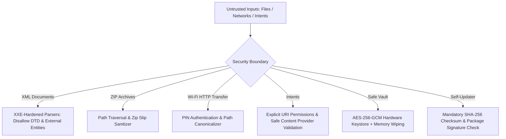

<div align="center">


# MyDoc

**The high-performance, offline-first document workstation, media player, and cryptographic safe vault for Android.**

[](https://kotlinlang.org/)
[](https://developer.android.com/jetpack/compose)
[](https://developer.android.com)
[](#security--privacy-architecture)
[](#open-source-licenses)

</div>

---

> [!NOTE]
> **Zero Ads. Zero Telemetry. Zero Cloud Sync. Zero Accounts.**  
> MyDoc is crafted for professionals and privacy-conscious users who demand a lightning-fast, beautiful workstation that operates completely on-device without internet dependencies.

---

## ⚡ Key Highlights

* **🎨 Content-First Design System**: Hand-tuned **AMOLED Pure Black (`#000000`)** and **Crisp Material White (`#FFFFFF`)** palettes, fluid edge-to-edge Compose layouts, and a floating glassmorphic dock.
* **📄 Vector-Sharp Document Engine**: Powered by **Artifex MuPDF Fitz** for desktop-grade sub-pixel rendering, smooth fling momentum, and pinch-to-zoom up to 500%.
* **📚 E-Book & EPUB Support**: Native rendering for `.epub`, `.xps`, `.oxps`, and `.cbz` with outline TOC navigation and reading progress restoration.
* **🌙 AMOLED PDF Inversion & Reading Shaders**: Instant zero-latency color inversion (pure black background with crisp white text), Sepia, and Eye-Comfort reading modes.
* **⚡ Android Quick Settings Tiles**: Notification drawer tiles for **Quick Scan** (instant camera scanner) and **PC Wi-Fi** (one-tap local wireless server).
* **📊 2D High-Performance Spreadsheets**: Custom virtualized 2D grid viewer for `.xlsx` and `.csv` with frozen row/column headers, multi-sheet tabs, and cell-level search.
* **🎬 LibVLC 3.6.5 Hardware-Accelerated Media**: Full-codec video and audio player with gesture controls, multi-track audio/subtitles, and 200% audio boost.
* **🔒 Hardware-Backed Safe Vault**: AES-256-GCM encryption with biometric authentication, in-memory decryption previews, and multi-pass DoD-grade zero-fill shredding.
* **🌐 Sandboxed Wi-Fi Sharing**: Local Wi-Fi HTTP file server for high-speed cable-free transfers to and from desktop browsers, secured with dynamic PINs and path traversal protections.
* **🛡️ Hardened Security Core**: Protection against XXE (XML External Entity) attacks, Zip Slip vulnerabilities, intent spoofing, and cloud backup data leaks.

---

## 📖 Feature Matrix & Engine Breakdown

### 1. Document Viewer & PDF Toolkit

| Format | Extension | Rendering Engine | Capabilities |
| :--- | :--- | :--- | :--- |
| **PDF** | `.pdf` | **Artifex MuPDF Fitz** | Sub-pixel vector rasterization, pinch-to-zoom (up to 500%), vertical continuous scroll, horizontal page-flip, dual-page book spread, full-text search with bounding highlights, table of contents/outline drawer, thumbnail strip, password unlocking, AMOLED color inversion, and on-device OCR text extraction. |
| **E-Books** | `.epub`, `.xps`, `.cbz` | **MuPDF Fitz** | Reflowable book viewing, outline chapter navigation, reading progress memory, and night reading modes. |
| **Word** | `.docx`, `.doc` | **MuPDF Fitz / HTML5 Engine** | Smooth layout rendering, fling scrolling, pinch-zoom, and in-document text search. |
| **PowerPoint**| `.pptx`, `.ppt` | **MuPDF Fitz / Native** | High-fidelity slide-by-slide viewing, swipe navigation, and thumbnail slide strip. |
| **Excel & CSV**| `.xlsx`, `.csv`, `.tsv` | **Custom Virtualized 2D Grid** | High-performance streaming OpenXML reader, frozen column headers (`A, B, C...`), frozen row headers (`1, 2, 3...`), multi-sheet tab switcher, auto-calculated column widths, and in-sheet cell search. |
| **Plain Text** | `.txt`, `.md`, `.log` | **Native Text Engine** | Instant file loading, dynamic typography scaling, and search highlighting. |
| **PDF Tools** | `.pdf` | **On-Device PDF Engine** | Merge multiple PDFs, split ranges, compress file size, reorder/rotate pages, digital signature canvas, and camera paper scanner with memory-safe perspective deskewing. |

---

### 2. Media Player & Photo Gallery

* **Video Player (VideoLAN LibVLC 3.6.5)**:
  * Full hardware decoding across MKV, MP4, AVI, MOV, FLV, and WebM.
  * Intuitive dual-axis gestures: swipe left for brightness, swipe right for volume, horizontal swipe for precise scrubbing.
  * Audio boost up to 200%, playback speed control (0.25x – 2.0x), multi-track audio/subtitle picker, and aspect ratio cycling.
  * Continuous screen-on wake lock and automatic position resumption.
* **Photo Viewer & Inspector**:
  * Deep zoomable image canvas with full-screen immersive mode.
  * EXIF metadata inspector (ISO, aperture, exposure, focal length, camera model, timestamp).
  * 30-day auto-purge Recycle Bin with instant MediaStore re-indexing via `MediaScannerConnection`.

---

### 3. File Manager, Safe Vault & Wi-Fi Transfer

* **Storage Manager**:
  * Dual-pane directory navigator with folder size meters, search, and multi-selection batch operations.
  * Integrated ZIP compressor and extractor with path-traversal safeguards.
  * Cryptographic file checksum generator (SHA-256 and MD5).
* **Safe Vault**:
  * Hardware-backed keystore integration generating unique AES-256-GCM symmetric keys.
  * Biometric authentication (fingerprint/face unlock) and master PIN fallback with PBKDF2 key derivation.
  * In-memory decryption previews (plain files never hit disk cache).
  * Multi-pass zero-fill file shredding for irreversible data destruction.
* **PC Wi-Fi Direct Transfer**:
  * High-speed HTTP file server running directly on device over local Wi-Fi.
  * Dynamic PIN-code verification preventing unauthorized local network access.
  * Drag-and-drop file uploading and batch downloading from any modern desktop browser without third-party cables or internet access.

---

## 🛡️ Security & Privacy Architecture

MyDoc was audited and architected with a **zero-trust, security-first** approach:



1. **XXE & XML Bomb Defenses**: All XML parsing pipelines (DOCX, PPTX, XLSX) strictly disable external DTDs (`disallow-doctype-decl`), external general entities, and parameter entities, neutralizing billion-laughs expansion attacks.
2. **Path Traversal & Zip Slip Immunity**: Archive extractions and Wi-Fi transfer paths are validated against canonical root paths before write execution.
3. **Cloud Backup Exclusions**: `backup_rules.xml` and `data_extraction_rules.xml` strictly exclude cryptographic keystores, vault databases, and shared preferences from automated cloud backups.
4. **Memory-Safe Decryptors**: Cleartext keys and sensitive byte buffers are zeroed out (`fill(0)`) immediately after cipher execution.
5. **Tamper-Evident Self-Updates**: Optional GitHub release updater enforces SHA-256 hash checks and package signature matching before triggering Android's `PackageInstaller`.

---

## 🏛️ Clean Architecture & Codebase Structure

The project follows strict **MVVM + Clean Architecture** with unidirectional data flow (UDF):

```
app/src/main/java/com/abhisheksati/mydoc/
├── data/
│   ├── local/              // Room database (AppDatabase), DAOs, Entities, SettingsRepository
│   └── repository/         // StorageRepositoryImpl, MediaRepositoryImpl, DocumentRepositoryImpl
├── domain/
│   ├── model/              // DocumentFile, MediaItem, StorageItem, TrashItem, ViewState
│   └── repository/         // Core abstract repository contracts
├── designsystem/
│   ├── components/         // AppTabHeader, AppDialog, AppEmptyState, AppSearchField
│   └── tokens/             // AppColors, AppTypography, AppSpacing (Unified Design Tokens)
├── rendering/
│   ├── engine/             // DocumentRenderer, MuPdfRenderer, AndroidPdfRenderer
│   ├── cache/              // TileBitmapCache (heap-bounded LruCache with bitmap recycling)
│   └── spreadsheet/        // Streaming OpenXML & CSV parser, SheetData
├── security/
│   └── vault/              // VaultManager (AES-256-GCM encryption & secure shredder)
├── network/                // WifiServerManager (local HTTP Wi-Fi transfer server)
├── tools/                  // PDF Toolkit, Storage Cleaner, Document Scanner
├── update/                 // GitHubUpdateService, ApkDownloader, PackageInstallerHelper
├── viewmodel/              // HomeViewModel, FileManagerViewModel, MediaViewModel, ViewerViewModel
└── ui/
    ├── home/               // DocumentsTabContent, FloatingPillDock, HomeScreen
    ├── filemanager/        // FileManagerScreen, TrashBinSheet, StorageItemComponents
    ├── media/              // MediaTabContent, VideoPlayerScreen, PhotoViewerScreen
    ├── viewer/             // Master viewer, PDF viewer, Spreadsheet 2D grid viewer
    └── settings/           // SettingsScreen (unified preferences & storage diagnostics)
```

---

## 🛠️ Building & Developing

### Prerequisites
* **JDK 17 or JDK 21**
* **Android SDK** (API 26 through API 35, Build-Tools 35.0.0)
* **Gradle 8.11+ / Android Gradle Plugin 8.9+**

### Command Line Build

```bash
# Clone the repository
git clone https://github.com/abhisheksati132/mydoc.git
cd mydoc

# Run all unit tests
./gradlew testDebugUnitTest

# Run static code analysis and linting
./gradlew lintDebug

# Build Debug APK
./gradlew assembleDebug

# Build Production Release APK (with R8 ProGuard minification and resource shrinking)
./gradlew assembleRelease
# Output location: app/build/outputs/apk/release/app-release.apk
```

---

## 📜 Open Source Licenses

MyDoc proudly builds upon open-source software:

* **[Artifex MuPDF Fitz](https://mupdf.com/)**: Licensed under the [GNU Affero General Public License (AGPL v3)](https://www.gnu.org/licenses/agpl-3.0.html).
* **[VideoLAN LibVLC](https://www.videolan.org/vlc/libvlc.html)**: Licensed under the [GNU Lesser General Public License (LGPL v2.1+)](https://www.gnu.org/licenses/lgpl-2.1.html).
* **[Android Jetpack & Compose](https://developer.android.com/jetpack)**: Licensed under the [Apache License, Version 2.0](https://www.apache.org/licenses/LICENSE-2.0).
* **[ZXing QR Code Engine](https://github.com/zxing/zxing)**: Licensed under the [Apache License, Version 2.0](https://www.apache.org/licenses/LICENSE-2.0).
* **[NanoHTTPD](https://github.com/NanoHttpd/nanohttpd)**: Licensed under the [Modified BSD License](https://opensource.org/licenses/BSD-3-Clause).

---

<div align="center">
<b>Crafted with precision for speed, security, and true offline independence.</b>
</div>
