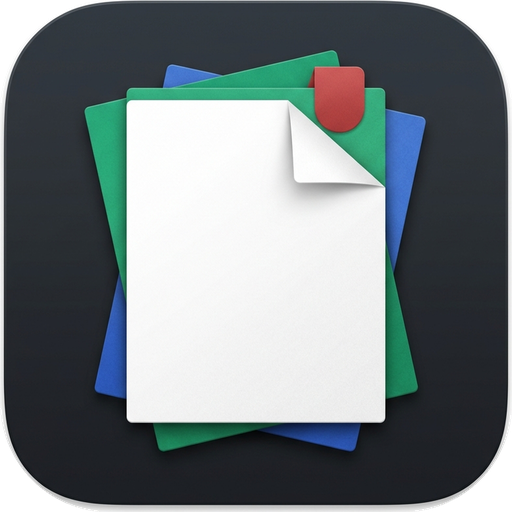

<div align="center">



# MyDoc

**Fast. Private. Beautiful.**  
A modern, distraction-free document reader & PDF toolkit for Android.

[](https://github.com/abhisheksati132/mydoc/releases/latest)
[-3DDC84?style=for-the-badge&logo=android&logoColor=white)](https://developer.android.com)
[](https://kotlinlang.org)
[](https://developer.android.com/jetpack/compose)
[](SECURITY.md)

<br/>

[**Download Latest APK**](https://github.com/abhisheksati132/mydoc/releases/latest) • [**Features**](#-features) • [**Security**](#-security) • [**Tech Stack**](#-built-with) • [**License**](#-license)

</div>

---

## ✨ Features

### 📖 Universal Reader
- **High-Performance PDF Engine**: Powered by Artifex MuPDF Fitz with sub-pixel vector rendering, continuous scroll, and up to 500% zoom.
- **Office & Books**: Native readers for `.docx`, `.xlsx`, `.pptx`, `.epub`, and plain text.
- **Reading Continuity**: Remembers your exact page, scroll position, and reading progress.

### 🛠️ On-Device PDF Toolkit
- **Organize**: Merge multiple documents, split ranges, extract, and rotate pages.
- **Optimize**: Compress file size with smart image downsampling and repair broken PDF streams.
- **Convert**: Images to PDF, PDF to image bundles (ZIP), and text extraction.
- **Security & Sign**: Draw digital signatures, add/remove AES-256 passwords, and strip metadata.
- **Camera Scanner**: Auto-edge detection, perspective crop, and crisp B&W document enhancements.

### ⚡ Tactile & Expressive Design
- **Fluid Physics**: Spring damping press physics, smooth animated list transitions, and interactive ripples.
- **Smart Organization**: Instant sub-category filtering (`PDF`, `Word`, `Excel`, `PPT`, `Text`).
- **OLED Ready**: Clean Light, Dark, and Pure AMOLED Black (`#000000`) modes.

### 🔒 Privacy-First Architecture
- **100% On-Device Processing**: 100% of document parsing, rendering, and manipulation happens locally on your device.
- **Zero Telemetry**: No analytics, no crash reporters, no tracking IDs, and no third-party network pings.
- **Transparent Network Policy**: The only network request made is an optional, user-controllable update check against public GitHub Releases (`api.github.com/repos/abhisheksati132/mydoc/releases/latest`). This can be toggled off at any time in Settings.
- **Zero Ads**: Free and open for everyone.

---

## 🚀 Quick Look

| Capability | Supported Formats / Tools |
|---|---|
| **Documents** | `PDF`, `DOCX`, `XLSX`, `PPTX`, `EPUB`, `TXT` |
| **Media Player** | Hardware-accelerated `MP4`, `MKV`, `MP3`, `FLAC` with gesture seek & PiP |
| **Tools** | Merge, Split, Compress, Sign, Encrypt, Decrypt, Convert, Rotate |
| **Scanner** | Real-time camera capture, perspective crop, multi-page PDF generation |
| **Updates** | Cryptographically verified in-app updater connected to GitHub Releases |

---

## 🛡️ Security

Security and user trust are core design pillars of MyDoc. For vulnerability reporting guidelines, please refer to [SECURITY.md](SECURITY.md).

### Cryptographic Release Signing & Verification
Official MyDoc releases are signed using an isolated release signing key. Releases are published with matching `.sha256` checksum files generated directly in the CI pipeline.

#### Verifying Checksums
To verify that your downloaded APK is untampered, compute its SHA-256 checksum and compare it with the published `<apk_name>.sha256` asset in the release:

**Linux / macOS:**
```bash
sha256sum -c mydoc-v*.apk.sha256
# or manually:
shasum -a 256 mydoc-v*.apk
```

**Windows (PowerShell):**
```powershell
Get-FileHash .\mydoc-v*.apk -Algorithm SHA256
```

#### Verifying Signing Certificate Fingerprint
You can verify the certificate used to sign the APK using Google's `apksigner` (from the Android SDK build-tools):

```bash
apksigner verify --print-certs mydoc-v*.apk
```

Compare the printed `Signer #1 certificate SHA-256 digest` with the fingerprint recorded in the GitHub Release notes and CI job summary.

### In-App Updater Hardening
The in-app updater implements multiple layers of defense:
- **HTTPS & Host Allowlisting**: Connections are strictly limited to `github.com`, `api.github.com`, and `*.githubusercontent.com`.
- **Redirect Limits**: At most 5 redirects are followed, strictly within allowed hosts.
- **Size Capping**: Downloads are capped at 200 MB with both `Content-Length` checks and stream byte accounting.
- **Mandatory SHA-256 Checksum**: The APK's cryptographic checksum must match the release's `<apk_name>.sha256` asset before installation is permitted.
- **Certificate Pinning**: In release builds, the updater inspects the downloaded APK package archive and enforces that its certificate fingerprint matches the pinned release certificate list (`RELEASE_CERT_SHA256`).

---

## 🛠️ Built With

- **Language**: [Kotlin 2.1.0](https://kotlinlang.org/)
- **UI Toolkit**: [Jetpack Compose](https://developer.android.com/jetpack/compose) with Material 3
- **Rendering Engine**: [Artifex MuPDF Fitz](https://mupdf.com/)
- **Media Engine**: [AndroidX Media3 ExoPlayer](https://developer.android.com/media/media3)
- **Local Storage**: Jetpack Room & SharedPreferences
- **Async & Reactive**: Kotlin Coroutines & Flow

See [THIRD_PARTY_NOTICES.md](THIRD_PARTY_NOTICES.md) for full licensing and attribution details for all third-party components.

---

## 📦 Building from Source

```bash
# Clone the repository
git clone https://github.com/abhisheksati132/mydoc.git
cd mydoc

# Run unit tests
./gradlew testDebugUnitTest

# Run Android Lint
./gradlew lintDebug

# Assemble Debug APK
./gradlew assembleDebug

# Assemble Release APK (requires release keystore environment variables)
MYDOC_KEYSTORE_PATH=/path/to/release.jks \
MYDOC_KEYSTORE_PASSWORD=*** \
MYDOC_KEY_ALIAS=*** \
MYDOC_KEY_PASSWORD=*** \
./gradlew assembleRelease
```

---

## 📄 License

MyDoc is licensed under the **GNU Affero General Public License v3.0 (AGPLv3)**. See [LICENSE](LICENSE) for details.
