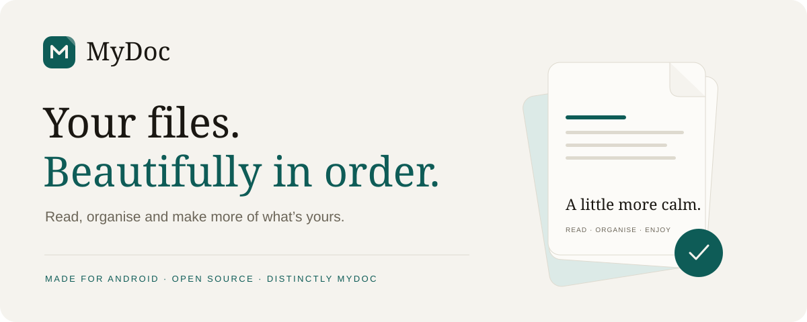

<picture>
  <source media="(prefers-color-scheme: dark)" srcset="assets/brand/readme-hero-dark.svg">
  
</picture>

  

**A calmer home for your files. A capable companion for your documents.**

Find the file. Pick up your reading. Make that PDF work for you. 
MyDoc brings your everyday file essentials together in one thoughtfully designed Android app.

 

Android 8.0+ &nbsp; · &nbsp; Free & open source

**New in 1.9.6:** richer offline Word viewing, password-protected documents and quick file previews.

[What’s new](CHANGELOG.md) &nbsp; / &nbsp; [Share an idea](https://github.com/abhisheksati132/mydoc/issues)

 

## Less searching. More doing.

<table>
<tr>
<td width="50%" valign="top">

### Everything in its place
Browse folders, pin your go-to locations and move between tabs. Find files with search and saved searches. Peek inside ZIPs and extract just what you need.

</td>
<td width="50%" valign="top">

### One more chapter
Open PDFs, Office documents, ebooks and text. Return to recent files and pick up where you left off, with reading preferences that feel like yours.

</td>
</tr>
<tr>
<td width="50%" valign="top">

### Small tasks. Handled.
Merge, split, reorder and compress PDFs. Turn images into a document or scan a page. Useful tools, right beside your files.

</td>
<td width="50%" valign="top">

### Room for more than work
View your images, play audio and video, and explore what’s taking up space. Your library goes beyond documents.

</td>
</tr>
</table>

 

## A little more calm. A lot more MyDoc.

Warm paper. Deep graphite. A touch of teal. MyDoc’s **Ink & Seal** design brings considered typography and subtle glass controls to the everyday.

Choose light, dark or pure AMOLED black. Switch between compact file lists and previews. Make yourself at home.

> **Every document. On your device. Yours.** 
> Read and work with local files, with document tools that run on your phone.

 

## Your next favourite app is a download away.

Get MyDoc from **[GitHub Releases](https://github.com/abhisheksati132/mydoc/releases/latest)**. Open the latest release, download the **universal APK** if you’re unsure which to choose, and install it on your Android device.

Then open a folder, find something worth reading, and settle in.

PDF · Word · Excel · PowerPoint · EPUB · Text · Images · Audio · Video Office documents are available for viewing; layout support varies by format.

 

---

### Built with care. Shared with everyone.

Made with love by **[Abhishek Sati](https://github.com/abhisheksati132)**.

Have a little detail you’d love to see improved? [Tell us](https://github.com/abhisheksati132/mydoc/issues). 
If MyDoc has found a place on your phone, a star helps others find it too.

[AGPL-3.0](LICENSE) &nbsp; · &nbsp; [Open-source credits](THIRD_PARTY_NOTICES.md)

