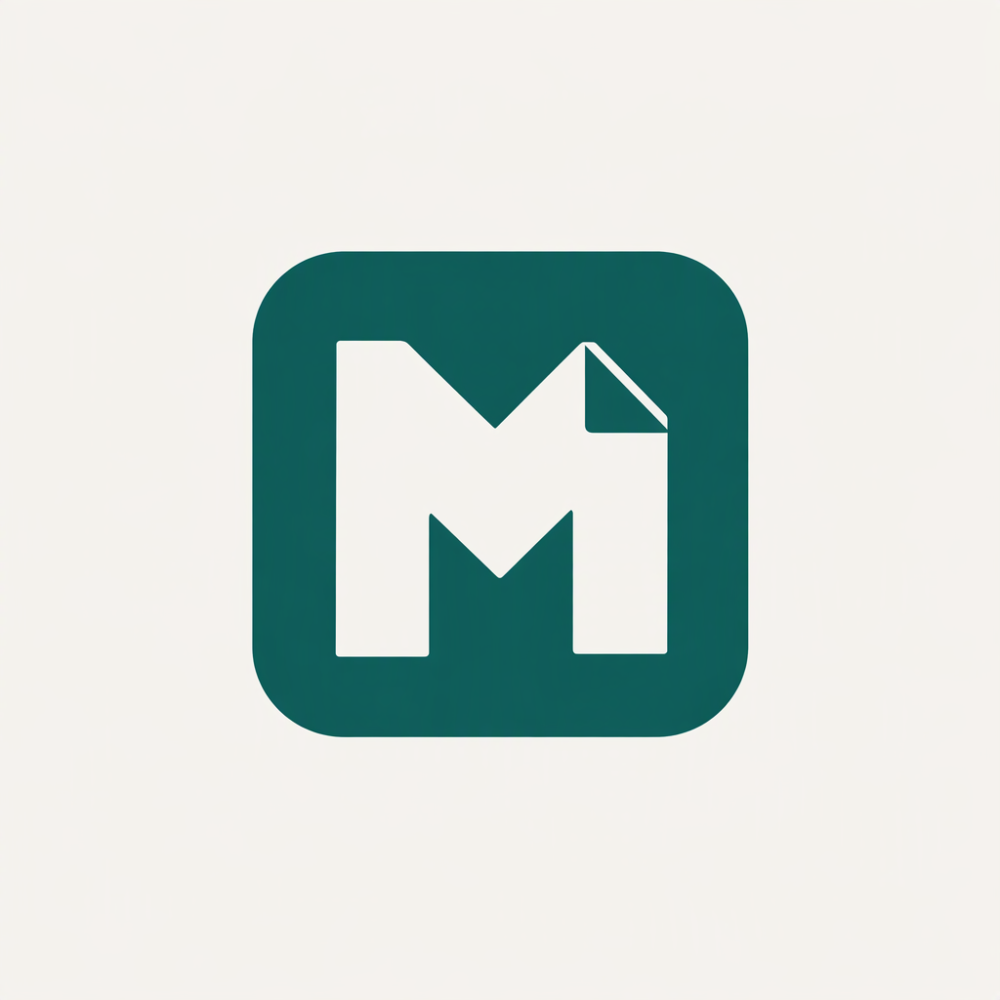

<div align="center">



# MyDoc

**Every document. On your device. Yours.**
*The private, local-first reader, office viewer, and on-device PDF toolkit for Android — built in the "Ink & Seal" design language.*

[](https://github.com/abhisheksati132/mydoc/releases/latest)
[-3DDC84?style=for-the-badge&logo=android&logoColor=white)](https://developer.android.com)
[](https://kotlinlang.org)
[](https://developer.android.com/jetpack/compose)
[](SECURITY.md)
[](https://github.com/abhisheksati132/mydoc/actions)
[](LICENSE)

<br/>

[📥 **Download Latest APK (v1.6.0)**](https://github.com/abhisheksati132/mydoc/releases/latest) • [✨ **Features**](#-features) • [🎨 **Brand & Design**](#-brand--design) • [🛡️ **Security & Integrity**](#-security--cryptographic-verification) • [📊 **Supported Formats**](#-format-support-matrix) • [🛠️ **Build & Test**](#-building-from-source)

</div>

---

## 🌟 What is MyDoc?

**MyDoc** is an all-in-one Android document reader and utility engineered from the ground up for speed, offline privacy, and tactile elegance. Powered by the **Artifex MuPDF Fitz** rendering engine, streaming Office parsers, and modern Jetpack Compose with a translucent "Liquid Glass" surface system, MyDoc delivers fast file reading and advanced PDF operations — completely on-device, with no telemetry, no accounts, and no cloud reliance. It is the local-first alternative to Office / Drive / WPS: your documents stay yours.

---

## 🎨 Brand & Design

MyDoc follows a documented design system — **"Ink & Seal"** — a quiet-luxury, restrained visual language. The full source of truth is [`docs/brand-identity.md`](docs/brand-identity.md).

- **Positioning:** calm, private, every-format. Restraint over density; one accent, used with intent.
- **Color:** warm bone / graphite chrome, a single **Seal-teal** accent (`#0E5C57` light, `#4FB0A6` dark) and a **brass** micro-accent (`#A67C3D`) reserved for the seal and premium touches. Format colors are desaturated to warm letterpress tones.
- **Type:** Fraunces (display) + Inter (UI) + JetBrains Mono (metadata).
- **Mark:** a wax-seal emblem — a teal rounded square holding a cream folded-corner document — used as the launcher, splash, and monochrome icon.
- **Guardrails:** no gradients/aurora/glow, no emoji icons, color is never the only signal, motion respects the system reduced-motion setting.

---

## ✨ Features

### 📖 High-Performance Universal Reader
* **Sub-Pixel Vector PDF Engine**: Backed by MuPDF C++ native core with crisp text anti-aliasing, continuous vertical or horizontal scrolling, and fluid zoom up to 600%.
* **Streaming Office Reader**: Native, zero-OOM parsers for `.docx`, `.xlsx`, and `.pptx` powered by streaming pull parsers and virtualized Compose layouts.
* **E-Books & Text**: Integrated EPUB reader with adjustable typography and instant plain text (`.txt`, `.log`, `.md`) rendering.
* **Reading Continuity & State Restoration**: Automatically saves and restores page numbers, scroll offsets, zoom levels, and recent file timestamps.
* **Multi-Format Tab Categorization**: Library automatically segregates documents into intuitive sub-groups (`PDF`, `Word`, `Excel`, `PPT`, `Text`).

### 🛠️ On-Device PDF Toolkit
Run professional PDF transformations entirely offline on your phone:
* **Organize & Structure**:
  * **Merge**: Seamlessly combine multiple PDF documents into a single cohesive file.
  * **Split**: Extract arbitrary page intervals or single pages into independent files.
  * **Reorder & Rotate**: Drag-and-drop page reorganization with non-negative normalized 90°/180°/270° orientation control.
* **Security & Privacy**:
  * **Digital Signature**: Responsive touch signature canvas with auto-bounds normalization and custom ink colors.
  * **AES-256 Encryption**: Protect sensitive PDFs with robust user and owner passwords.
  * **Decryption / Unlock**: Strip security restrictions from password-protected documents.
  * **Targeted Redaction**: Permanently excise sensitive confidential keywords from vector PDF streams.
  * **Metadata Sanitizer**: Purge author, creation date, GPS, and editor telemetry from PDF metadata dictionaries.
* **Optimization & Conversion**:
  * **Smart Compaction**: Multi-tier compression with xref table compacting and stream deflation that preserves vector sharpness.
  * **Damaged Document Repair**: Rebuild and salvage corrupted PDF xref tables and damaged page streams.
  * **Image Bundles**: Convert photo galleries into multi-page PDFs, or extract PDF pages into compressed ZIP image bundles.
  * **Camera Document Scanner**: Real-time camera viewfinder with perspective detection, document sharpening, and instant PDF compilation.

### 🧹 Storage Cleaner & Data Safety Engine
* **System Directory Immunity**: Built-in whitelist guarantees essential directories (`Download`, `DCIM`, `Documents`, `Pictures`, `Music`, `Movies`, `Android`) are never deleted.
* **Active Download Protection**: In-flight browser downloads (`.crdownload`, `.part`) are detected and strictly preserved.
* **Atomic 30-Day Trash Purge**: Scheduled cleanup transactionally purges both SQLite metadata and unlinks physical files from the `.trash` directory.
* **Zip Slip Traversal Defense**: All archive extraction operations enforce strict canonical path boundary validation.

### 🎨 Tactile Liquid Glass & Physics
* **Liquid Glass Aesthetic**: Translucent glass-morphism surfaces with dynamic lighting and blur effects.
* **Spring Dynamics**: Material 3 physics with responsive spring-damping press feedback and swipeable tab navigation.
* **True AMOLED Black Mode**: High-contrast pure black (`#000000`) theme engineered for maximum battery efficiency on OLED displays.

---

## 📊 Format Support Matrix

| Category | Extensions | Capabilities |
| :--- | :--- | :--- |
| **PDF Documents** | `.pdf` | Full vector render, continuous scroll, search, bookmarks, outline, annotations, signing, print |
| **Word Processing** | `.docx`, `.doc`, `.rtf` | Streaming XML rendering, heading hierarchy, tables, text extraction fallback for legacy formats |
| **Spreadsheets** | `.xlsx`, `.xls`, `.csv` | Virtualized viewport grid, cell formula separation, multi-sheet tab navigation |
| **Presentations** | `.pptx`, `.ppt`, `.pptm` | Native slide deck viewer, slide thumbnails, notes viewer, shape text extraction |
| **E-Books & Text** | `.epub`, `.txt`, `.log`, `.md` | Dynamic reflow typography, chapter navigation, raw source inspection |
| **Media & Audio** | `.mp4`, `.mkv`, `.mp3`, `.flac` | Hardware-accelerated ExoPlayer, picture-in-picture, audio background playback |

---

## 🔒 Privacy & Architecture

MyDoc is architected around the **Zero-Trust Local-First** principle:

1. **Zero Cloud Uploads**: All document parsing, rendering, text recognition (OCR), and PDF modifications take place strictly inside the on-device sandbox.
2. **Zero Telemetry**: No Google Analytics, Firebase Analytics, Crashlytics, Mixpanel, or advertising SDKs.
3. **Transparent Network Access**: The only network calls made by MyDoc are:
   - Querying the public GitHub Releases API for software updates (can be disabled in Settings).
   - Downloading the ML Kit text recognition model on first OCR run (handled directly by Google Play Services).
4. **Android Cloud Backup Hardening**: Backup manifests explicitly exclude cached documents, trash archives, and user credentials.

---

## 🛡️ Security & Cryptographic Verification

All official MyDoc releases are built through automated GitHub Actions CI and cryptographically signed with our dedicated release certificate.

### Verifying Release Checksums

Every release includes published `.sha256` checksum files generated directly during build assembly. Verify your download:

#### Linux / macOS:
```bash
sha256sum -c mydoc-v*.apk.sha256
```

#### Windows (PowerShell):
```powershell
Get-FileHash .\mydoc-v*.apk -Algorithm SHA256
```

### Verifying the Signing Certificate

Inspect the APK certificate with `apksigner` (from the Android SDK build-tools):

```bash
apksigner verify --print-certs mydoc-v*.apk
```

Compare the `Signer #1 certificate SHA-256 digest` with the fingerprint published in the [GitHub Release notes](https://github.com/abhisheksati132/mydoc/releases).

---

## 🛠️ Building from Source

### Prerequisites
- **JDK 21** (e.g. Eclipse Temurin 21)
- **Android SDK** (compileSdk 37 platform, build-tools 36.0.0+)
- **Gradle** via the wrapper (Gradle 9.6.0, AGP 9.5.0)
- **Git**

### Build Commands

```bash
# 1. Clone repository
git clone https://github.com/abhisheksati132/mydoc.git
cd mydoc

# 2. Run the unit test suite
./gradlew testDebugUnitTest

# 3. Run Android Lint inspection
./gradlew lintDebug

# 4. Assemble Debug APK (all ABIs & universal)
./gradlew assembleDebug

# 5. (optional) Run instrumented UI tests on a booted API 35+ device/emulator
./gradlew connectedDebugAndroidTest

# Output APKs will be generated in:
# app/build/outputs/apk/debug/app-universal-debug.apk
```

### Release Build (Signed)
```bash
MYDOC_KEYSTORE_PATH=/path/to/release.jks \
MYDOC_KEYSTORE_PASSWORD=*** \
MYDOC_KEY_ALIAS=*** \
MYDOC_KEY_PASSWORD=*** \
MYDOC_RELEASE_CERT_SHA256=*** \
./gradlew assembleRelease
```

---

## 🧱 Tech Stack & Dependencies

* **Language**: [Kotlin 2.3.21](https://kotlinlang.org/) (Coroutines, Flow, Serialization)
* **Build**: [AGP 9.5.0](https://developer.android.com/build) + [Gradle 9.6.0](https://gradle.org/), KSP 2.3.13, compileSdk 37 / targetSdk 35 / minSdk 26
* **UI**: [Jetpack Compose](https://developer.android.com/jetpack/compose) (BOM 2026.09.00) with Material Design 3 + [Haze](https://github.com/chrisbanes/haze) live backdrop blur
* **PDF Core**: [Artifex MuPDF Fitz](https://mupdf.com/) (Native JNI bindings)
* **Secondary PDF Core**: [PDFBox-Android](https://github.com/TomRoush/PdfBox-Android)
* **Media**: [AndroidX Media3 ExoPlayer 1.11.1](https://developer.android.com/media/media3)
* **Database**: [Jetpack Room 2.8.5](https://developer.android.com/training/data-storage/room)
* **Image Loading**: [Coil 2.7.0](https://coil-kt.github.io/coil/)

---

## 📄 License

MyDoc is licensed under the **GNU Affero General Public License v3.0 (AGPLv3)**.  
See the [LICENSE](LICENSE) file for complete terms. Full attributions for open-source components are documented in [THIRD_PARTY_NOTICES.md](THIRD_PARTY_NOTICES.md).
