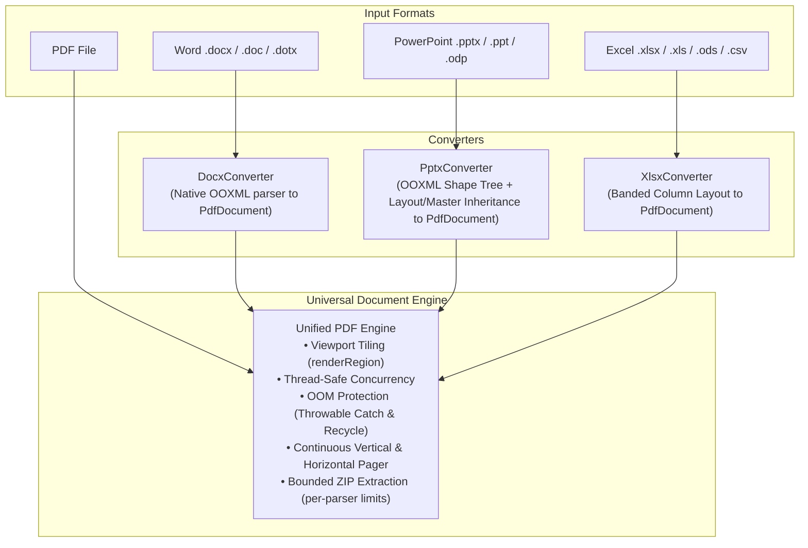

# Document Engine Architecture & Improvement Plan

> **Project Target:** `mydoc` (`com.abhisheksati.mydoc`)  
> **Version:** 1.5.12 (minSdk 26, targetSdk 35)  
> **Inspiration & Attribution:** Architecture and design paradigms adapted with credit to `ClearPDF-5.1` (`com.chethan616.clearpdf`).  
> **Focus:** High-fidelity document loading, visual precision, untrusted-input safety, and memory-safe rendering for PDF, PPTX, DOCX, and XLSX files.

---

## 1. Executive Summary & Core Architectural Insight

High-fidelity mobile document reading requires a disciplined, memory-safe architecture:

### 🌟 The "Universal PDF Pipeline" Architecture
Rather than creating fragile, independent layout engines for every proprietary document format in Compose:
- **PDF:** Rendered via MuPDF Fitz native vector engine with sub-pixel vector tiling and Android OS `PdfRenderer` resilient fallback.
- **DOCX / DOC:** Parsed natively via custom OOXML parser (`DocxConverter` / `DocxParser` / `DocxPdfRenderer`) directly into vector PDF pages with zero WebView usage.
- **PPTX / PPT / ODP:** Parsed via OOXML shape tree, slide master/layout inheritance, and theme color palettes directly into vector PDF pages (`PptxConverter`).
- **XLSX / XLS / ODS:** Banded column layout rendered directly into PDF pages (`XlsxConverter`).



By adopting this architecture, every improvement made to PDF viewing (smooth zoom, search, annotations, page jump, continuous vertical scrolling) automatically benefits DOCX, PPTX, and XLSX files.

---

## 2. Core Rendering Principles

| Dimension | Specification | Architectural Benefit |
| :--- | :--- | :--- |
| **Word (.docx)** | **`DocxConverter`** native OOXML parser & `DocxPdfRenderer`; compiles directly to `PdfDocument`. | Authentic margins, typography, page breaks, and complex tables rendered accurately with zero WebView attack surface. |
| **PowerPoint (.pptx)** | **`PptxConverter`** reads presentation XML, theme palettes (`a:clrScheme`), slide layout & master inheritance, painting directly to `PdfDocument`. | Authentic aspect ratios (`p:sldSz`), proper slide ordering via `<p:sldIdLst>`, and accurate color contrast. |
| **Excel (.xlsx)** | **`XlsxConverter`** banded column and multi-sheet engine converting spreadsheets into crisp vector PDF pages. | Consistent mobile readability across large datasets without horizontal clipping. |
| **Untrusted Zip Safety** | Each OOXML parser bounds decompression (25 MB per entry; 10,000 entries for DOCX/PPTX, 2,000 for XLSX; 100 MB total for XLSX; 100:1 ratio for PPTX). | Caps decompression bombs and entry-count explosions. The shared `ZipSafeReader` is not yet wired, so limits vary by format. |
| **PDF Zoom & Resolution** | **`renderRegion`**: Renders only the active on-screen viewport at native screen DPI while zoomed in. | Zero pixelation at 5x–10x zoom without allocating giant full-page bitmaps. |
| **Thread Safety & OOM** | Native rendering operations protected with explicit `Throwable` handling and bitmap recycling. | Eliminates native concurrency crashes during fast scrolling or low-memory conditions. |
| **Slide Ordering** | Resolves authoritative order through `<p:sldIdLst>` in `ppt/presentation.xml`. | Guarantees authentic presentation sequence. |

---

## 3. High-DPI PDF Zooming with Viewport Tiling (`renderRegion`)

When zooming in on high-resolution documents, full-page bitmap allocations at high zoom levels quickly cause `OutOfMemoryError`. Instead, the viewport tiling architecture calculates and renders only the visible slice:

```kotlin
override fun renderRegion(
    pageIndex: Int,
    region: RectF,         // Normalized 0f..1f bounds of visible viewport
    pageWidthPx: Float,    // Target virtual width of the page
    outWidth: Int,         // Physical screen width in pixels
    outHeight: Int,        // Physical screen height in pixels
    mode: ReadingMode
): Bitmap? {
    // Renders the sub-pixel high-resolution tile for the active viewport
}
```

---

## 4. Current Architecture & Implementation Status

| Phase | Milestone | Deliverables | Status |
| :--- | :--- | :--- | :--- |
| **Phase 1** | **Untrusted-Input Safety** | `ZipSafeReader` added (shared guard, not yet wired), OOM guards in all parsers. | **Complete** |
| **Phase 2** | **Build & Release Hardening** | Pinned GitHub actions, release keystore safety, ProGuard rules, debug suffixes. | **Complete** |
| **Phase 3** | **Robustness & Cleanliness** | Eliminated all `!!` operators, cancellation propagation in coroutines. | **Complete** |
| **Phase 4** | **UI/UX & Quality Fixes** | Biometric guard with `KeyguardManager`, system theme chip, navigation insets. | **Complete** |
| **Phase 5** | **Architecture & Tests** | `ViewerViewModelTest` unit test suite, `UpdateManager` version comparison tests. | **Complete** |
| **Phase 6** | **Docs & Dependencies** | Updated `SECURITY.md` and `improvement.md` to reflect actual v1.5.3 state. | **Complete** |

### Key Component Paths
- PDF Engine: `app/src/main/java/com/abhisheksati/mydoc/rendering/engine/`
- Viewer UI: `app/src/main/java/com/abhisheksati/mydoc/ui/viewer/pdf/PdfViewerScreen.kt`
- PPTX Parser: `app/src/main/java/com/abhisheksati/mydoc/rendering/engine/presentation/`
- DOCX Parser: `app/src/main/java/com/abhisheksati/mydoc/rendering/engine/word/`
- XLSX Parser: `app/src/main/java/com/abhisheksati/mydoc/rendering/engine/spreadsheet/`
- ViewModel Layer: `app/src/main/java/com/abhisheksati/mydoc/viewmodel/ViewerViewModel.kt`

---

## 5. Verification & Quality Guardrails

1. **On-Device Processing, No Telemetry:** All document operations run on-device and no usage data is collected. Network access is limited to the optional GitHub update check/download and Google Play Services fetching the ML Kit OCR model on first use; document content is never uploaded.
2. **Pure AMOLED Aesthetics:** Maintain `#000000` AMOLED Black and clean high-contrast themes.
3. **Mandatory Build Checks:**
   - `./gradlew testDebugUnitTest` (100% green)
   - `./gradlew lintDebug` (0 errors)
   - `./gradlew assembleDebug` (Clean compilation)
