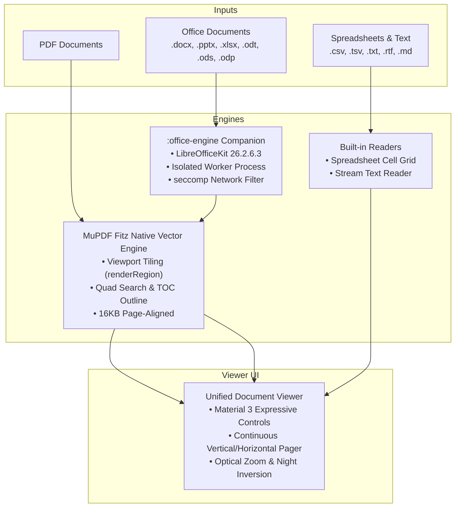

# Document Engine Architecture & Engineering Plan

> **Project Target:** `mydoc` (`com.abhisheksati.mydoc`)  
> **Current Version:** 2.0.5 (minSdk 26, targetSdk 35)  
> **Core Engine:** Artifex MuPDF Fitz 1.28.5 (16KB aligned) & LibreOfficeKit 26.2.6.3 companion module  
> **Focus:** High-fidelity document rendering, memory-safe sub-pixel viewport tiling, studio-grade Material You Bento UX, unified viewer gestures, and untrusted-input hardening.

---

## 1. Document Engine Architecture

MyDoc provides a robust, memory-safe document processing architecture tailored for modern Android devices (phones, foldables, and tablets):

### 🌟 Unified Document Pipeline
Rather than relying on insecure WebViews or fragile custom layout engines:
- **PDF Engine:** Rendered via native MuPDF Fitz (1.28.5, 16KB page-aligned) with sub-pixel viewport tiling (`renderRegion`), quad text search, table-of-contents outline parsing, and Android OS `PdfRenderer` fallback.
- **Office Documents (Word, PowerPoint, Excel):** Handled via the decoupled `:office-engine` companion module powered by LibreOfficeKit 26.2.6.3. Office files (`.docx`, `.doc`, `.odt`, `.pptx`, `.ppt`, `.odp`, `.xlsx`, `.ods`) are converted into vector PDF pages within an isolated worker process.
- **Built-in Fallback Readers:** When the companion engine is uninstalled or optional, MyDoc uses lightweight built-in readers:
  - **Excel / CSV / TSV:** Searchable, cached-value spreadsheet cell grid.
  - **RTF / Text / Markdown:** Bounded stream text reader with syntax framing.
- **PDF Manipulation Toolkit:** 20+ operations including vector watermarking, page reordering, compression, encryption, digital signing, and Google ML Kit on-device OCR.



---

## 2. Core Rendering & Memory Safety Principles

| Dimension | Specification | Architectural Benefit |
| :--- | :--- | :--- |
| **PDF Viewport Tiling** | **`renderRegion`**: Computes and renders only the visible sub-pixel viewport at native screen DPI during zoom. | Crisp rendering at 5x–10x zoom without allocating giant full-page bitmaps. |
| **Sandboxed Office Worker** | The `:office-engine` runs under an isolated worker process with seccomp filters blocking network sockets. | Complete crash isolation from the main UI process and defense-in-depth against malformed document exploits. |
| **Memory Budgets** | Strict memory and dimension caps (e.g., 4096px image decode budget, 64 MB input limits). | Prevents out-of-memory errors on low-RAM devices and eliminates JNI memory leaks. |
| **Atomic Cache Persistence** | Temporary renders and exports are staged with UUID filenames and committed atomically. | Eliminates corrupted, partially written files and invalid offline cache entries. |
| **Accessible Tap Targets** | Custom lint checks (`:lint-rules`) enforce descriptive `contentDescription` on all interactive controls. | Ensures full TalkBack accessibility across all screens and bottom sheets. |

---

## 3. High-DPI PDF Zooming with Viewport Tiling (`renderRegion`)

When zooming in on high-resolution documents, full-page bitmap allocations at high zoom levels quickly cause `OutOfMemoryError`. Instead, the viewport tiling architecture calculates and renders only the visible slice:

```kotlin
override fun renderRegion(
    pageIndex: Int,
    region: RectF,         // Normalized 0f..1f bounds of visible viewport
    pageWidthPx: Float,    // Target virtual width of the page
    outWidth: Int,         // Physical screen width in pixels
    outHeight: Int,        // Physical screen height in pixels
    mode: ReadingMode
): Bitmap? {
    // Renders the sub-pixel high-resolution tile for the active viewport
}
```

---

## 4. Engineering Milestones (v2.0.x)

| Milestone | Key Deliverables | Status |
| :--- | :--- | :--- |
| **Material 3 Expressive UI** | Complete redesign using Ink & Seal visual grammar, motion curves, and Liquid Glass optics. | **Complete** |
| **Modular Companion Engine** | Decoupled `:office-engine` companion module with LibreOfficeKit and verified F-Droid builds. | **Complete** |
| **Files & Storage Hub** | Decomposed `FilesScreen`, dual-pane foldable layout, Recycle Bin, and storage cleaner. | **Complete** |
| **Security Hardening** | Pinned release certificate fingerprint checks, private storage isolation, and continuous `FLAG_SECURE`. | **Complete** |
| **Release & CI Automation** | Pinned Gradle wrapper verification, cold-home release builds, and automated API 35 emulator smoke tests. | **Complete** |
| **Audit Resolution (v2.0.3)** | Fixed scanner image staging, structural PDF validation, Compose lint compliance, and version alignment. | **Complete** |
| **Audit Hardening (v2.0.4)** | Fixed ODS coordinate parsing bounds, hardened PDF redaction checks, scoped storage permissions, and Material You dynamic color adaptation. | **Complete** |
| **Studio UX & Cache Hygiene (v2.0.5)** | Storage cache clearing across memory and multi-volume disks, silenced layout fidelity dialog, unified Presentation viewer with ZoomableViewport, and 2-box-per-row Bento category grid. | **Complete** |

---

## 5. Verification & Quality Guardrails

1. **100% On-Device Processing:** All document operations run locally. Zero telemetry, tracking, or external analytics.
2. **Network Scoping:** Network access is restricted to user-initiated GitHub update checks/downloads and on-demand ML Kit OCR model initialization.
3. **Mandatory CI Build Quality Gates:**
   - `./gradlew testDebugUnitTest` (All unit test suites green)
   - `./gradlew lintDebug` (0 lint errors across `:app`, `:office-engine`, and `:lint-rules`)
   - `./gradlew assembleDebug` (Clean compilation and packaging)
