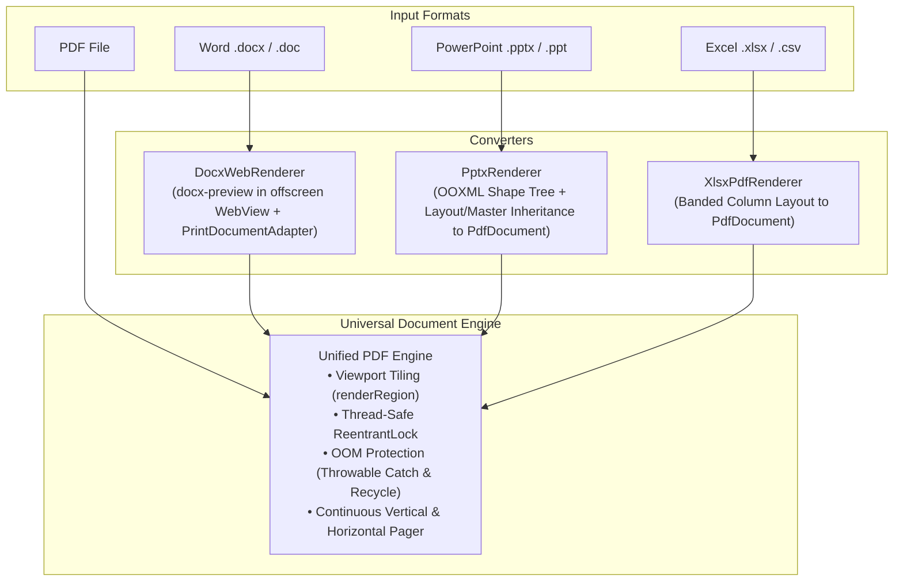
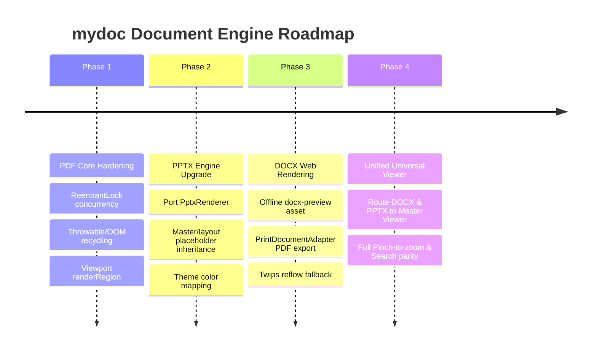

# Document Engine Improvement Plan: Lessons & Architecture from ClearPDF-5.1

> **Project Target:** `mydoc` (`com.abhisheksati.mydoc`)  
> **Source Analyzed:** `ClearPDF-5.1` (`com.chethan616.clearpdf`)  
> **Date:** October 19, 2026  
> **Focus:** Fixing document loading, visual fidelity, and rendering performance for PDF, PPT, and DOC files.

---

## 1. Executive Summary & Core Architectural Insight

After an in-depth analysis of `ClearPDF-5.1`, the fundamental difference between why `ClearPDF` opens documents reliably while `mydoc` struggles with layout, blank pages, or broken formatting boils down to **one foundational architectural strategy**:

### 🌟 The "Universal PDF Pipeline" Architecture
In `mydoc`, we currently try to write independent, ad-hoc Compose UI renderers for every file format:
- **PDF:** Rendered via MuPDF / AndroidPdfRenderer into Compose Image elements.
- **DOCX:** Parsed into text blocks and dumped into a standard `LazyColumn` (losing page breaks, real fonts, headers, footers, alignments, and tables).
- **PPTX:** Parsed into an elaborate custom `VisualElement` tree and drawn with nested Compose `Box`es and custom `Canvas` paths (causing severe layout clipping, font scaling bugs, slow recomposition, and memory pressure).

In contrast, **`ClearPDF` normalizes all documents into high-fidelity PDF representations** using lightweight, dependency-free local converters, and then funnels **all viewing, continuous scrolling, pinch-to-zoom, text search, and caching through a single, battle-tested PDF viewer engine**:



By adopting this architecture, every improvement we make to PDF viewing (smooth zoom, search, annotations, page jump, continuous vertical scrolling) **automatically benefits DOCX and PPTX files** without duplicating thousands of lines of fragile Compose UI code.

---

## 2. Detailed Comparison: `mydoc` vs. `ClearPDF-5.1`

| Dimension | Current `mydoc` Implementation | `ClearPDF-5.1` Implementation | Key Takeaway / Fix for `mydoc` |
| :--- | :--- | :--- | :--- |
| **Word (.docx)** | Reflows raw text into `LazyColumn` via `DocxParser.kt`. All margins, page breaks, headers, footers, and table columns are lost. | Uses **`DocxWebRenderer`** with `docx-preview` inside an offscreen WebView; prints to PDF via `PrintDocumentAdapter`. Fallback parses twips spacing (`w:ind`, `w:spacing`, `w:jc`). | **Huge upgrade:** Renders real pages, real margins, and tables as a 48KB offline asset rather than a 100MB native library. |
| **PowerPoint (.pptx)** | Parses XML into `VisualElement` and renders in Compose. Prone to clipping, font mismatch, and text wrap failures. | **`PptxRenderer`** reads presentation XML, theme colors (`a:clrScheme`), slide layout & master placeholder inheritance, and paints shapes, text, and images straight to `PdfDocument` pages. | Renders each slide at its authentic aspect ratio (`p:sldSz`) into a crisp vector PDF page. |
| **PDF Zoom & Resolution** | Scales whole page bitmaps or renders entire page at 1.8x. Causes pixelation or OOM crashes on high zoom levels. | **`renderRegion`**: Renders *only the on-screen visible viewport* (`detailTile`) at native screen DPI while zoomed in. | Zero blurriness at 5x–10x zoom without allocating giant bitmaps. |
| **Thread Safety & OOM** | Background coroutines can clash on native renderer handles; catches `Exception` which misses `OutOfMemoryError`. | Uses `ReentrantLock` around `PdfRenderer` and catches `Throwable` (safely recycling partial bitmaps on `OutOfMemoryError`). | Eliminates native crashes during fast scrolling or low-memory conditions. |
| **Slide Ordering** | Reads arbitrary ZipEntry order or filename numbers. | Reads `<p:sldIdLst>` in `ppt/presentation.xml` (authoritative presentation order). | Fixes bug where Slide 10 appears before Slide 2. |
| **Theme & Color Fidelity** | Hardcoded or basic hex colors. | Maps `a:overrideClrMapping` / `p:clrMap` through theme palettes with luminance modifiers (`lumMod`, `lumOff`). | Dark PowerPoint templates correctly display white text on dark backgrounds instead of unreadable black text. |

---

## 3. Deep Dive: How ClearPDF Solves Each Format

### 3.1 DOCX / Word Loading (`DocxWebRenderer.kt`)
Instead of bundling a massive 100MB LibreOffice or POI dependency, ClearPDF leverages the phone's built-in web rendering engine:
1. Loads an offline HTML bundle using `docx-preview.js` (~48KB).
2. Blocks all network access (`shouldInterceptRequest` returns 403 for any non-local URI).
3. Drives Android's `PrintDocumentAdapter` to write paginated vector PDF pages honoring CSS page breaks.
4. If printing is unavailable, it has a slice-rendering fallback that slices the layout height into standard A4 pages.
5. If the WebView fails entirely, it reflows the XML preserving twips indentation (`w:ind`), spacing before/after (`w:spacing`), and inline drawing images (`r:embed` -> rels -> media).

### 3.2 PPTX / Presentation Loading (`PptxRenderer.kt`)
`PptxRenderer` is an elegant, pure-Kotlin parser with zero extra dependencies:
- **Slide Dimensions:** Extracted from `ppt/presentation.xml` (`<p:sldSz cx="..." cy="..."/>`) converted from EMUs to points (`12700 EMU = 1 pt`).
- **Slide Order:** Read from `<p:sldIdLst>`, preventing zip entry order bugs.
- **Placeholder Inheritance:** When a slide shape lacks explicit coordinates (`<a:xfrm>`), it inherits them from `ppt/slideLayouts/slideLayoutX.xml` and `ppt/slideMasters/slideMasterX.xml`. This keeps slide titles and subtitles in their proper positions rather than stacking at `(0, 0)`.
- **Canvas Rendering:** Each slide is rendered to an Android `PdfDocument.Page` using `Canvas.drawRect`, `Canvas.drawBitmap`, and `StaticLayout` with `SpannableStringBuilder`.

### 3.3 High-DPI PDF Zooming with `renderRegion`
In `com.kyant.pdfcore.viewer.PdfViewerImpl`:
```kotlin
override fun renderRegion(
    document: PdfDocument,
    pageIndex: Int,
    region: RectF,         // Normalized 0f..1f bounds of visible viewport
    pageWidthPx: Float,    // Target virtual width of the page
    outWidth: Int,         // Physical screen width in pixels
    outHeight: Int         // Physical screen height in pixels
): Bitmap? = lock.withLock {
    val renderer = renderers[document.uri] ?: return null
    val page = renderer.openPage(pageIndex)
    var bitmap: Bitmap? = null
    try {
        val srcW = page.width.toFloat().coerceAtLeast(1f)
        val s = pageWidthPx / srcW
        bitmap = Bitmap.createBitmap(outWidth, outHeight, Bitmap.Config.ARGB_8888)
        bitmap.eraseColor(Color.WHITE)
        val matrix = Matrix().apply {
            postScale(s, s)
            postTranslate(-region.left * pageWidthPx, -region.top * (page.height * s))
        }
        page.render(bitmap, null, matrix, PdfRenderer.Page.RENDER_MODE_FOR_DISPLAY)
        bitmap
    } catch (t: Throwable) {
        bitmap?.recycle()
        null
    } finally {
        runCatching { page.close() }
    }
}
```
**Why this is superior:**
When the user pinches to 3x zoom on a page, instead of allocating a 3240x5760 (74MB uncompressed) bitmap for the whole page, it allocates only a 1080x1920 (8MB) bitmap representing *what is currently visible on the glass*.

---

## 4. Architectural Lessons for `mydoc`

1. **Avoid Reinventing Layout Engines in Jetpack Compose:**
   Compose is fantastic for application UI, but building an ad-hoc layout engine for Word or PowerPoint in Compose requires re-implementing text measurement, wrapping, kerning, word justification, and z-ordering. Normalizing to PDF delegates layout to established standards.
2. **Handle `OutOfMemoryError` Correctly:**
   In Kotlin/Android, `catch (e: Exception)` does **not** catch `OutOfMemoryError` because it inherits from `java.lang.Error`. Any high-resolution document renderer must catch `Throwable` and immediately call `bitmap.recycle()`.
3. **Thread-Safe Native Renderers:**
   Android's native `PdfRenderer` throws `IllegalStateException` if more than one page is opened concurrently. A `ReentrantLock` around native operations prevents background pre-fetch threads from crashing the UI.
4. **Authoritative Slide Ordering:**
   Never iterate through `.zip` entries to order slides in PowerPoint presentations. Always resolve `<p:sldIdLst>` in `ppt/presentation.xml`.

---

## 5. Concrete Action Plan & Implementation Roadmap



### Phase 1: Harden PDF Core Engine (`rendering/engine/`)
- Update [AndroidPdfRenderer.kt](file:///c:/Users/abhis/Downloads/project-base/myapp/app/src/main/java/com/abhisheksati/mydoc/rendering/engine/AndroidPdfRenderer.kt) and [MuPdfRenderer.kt](file:///c:/Users/abhis/Downloads/project-base/myapp/app/src/main/java/com/abhisheksati/mydoc/rendering/engine/MuPdfRenderer.kt):
  - Add `renderRegion(pageIndex, region, targetWidthPx, outWidth, outHeight)`.
  - Wrap native calls with `ReentrantLock`.
  - Replace `catch (e: Exception)` with `catch (t: Throwable)` and ensure `bitmap?.recycle()` is invoked.
- Wire `renderRegion` in [PdfViewerScreen.kt](file:///c:/Users/abhis/Downloads/project-base/myapp/app/src/main/java/com/abhisheksati/mydoc/ui/viewer/pdf/PdfViewerScreen.kt) to display a sharp detail tile overlay when `zoomScale > 1.2f`.

### Phase 2: Implement `PptxRenderer` (Presentation to PDF Engine)
- Port the clean, dependency-free OOXML engine from ClearPDF's `PptxRenderer.kt` into `com.abhisheksati.mydoc.rendering.engine.presentation`:
  - Authentic slide dimensions from `p:sldSz`.
  - Strict `<p:sldIdLst>` slide ordering.
  - Theme palette resolution with `a:clrScheme` and luminance modifiers.
  - Slide master and layout placeholder coordinate inheritance.
  - Shape trees (`p:spTree`), text boxes, tables, and media images drawn to `PdfDocument`.
- Cache converted presentations in `context.cacheDir/converted_presentations/` with SHA-256 validation.

### Phase 3: Implement `DocxWebRenderer` (Word to PDF Engine)
- Add the lightweight `docx-preview.js` asset (~48KB) to `app/src/main/assets/docx/`.
- Create `com.abhisheksati.mydoc.rendering.engine.word.DocxWebRenderer`:
  - Offscreen WebView running in an isolated sandboxed context (no internet permission required).
  - Convert via `PrintDocumentAdapter` to vector PDF.
  - Keep our existing `DocxParser` as a secondary fallback if WebView printing is unsupported on a specific legacy device.

### Phase 4: Route Documents to Unified Master Viewer
- In [ViewerViewModel.kt](file:///c:/Users/abhis/Downloads/project-base/myapp/app/src/main/java/com/abhisheksati/mydoc/viewmodel/ViewerViewModel.kt), route DOCX and PPTX through the `UniversalDocumentConverter`:
  - Automatically convert and cache as PDF on background dispatcher.
  - Open in the unified viewer with full support for:
    - Continuous vertical scrolling
    - Smooth pinch-to-zoom (backed by `renderRegion`)
    - In-document text search
    - Page thumbnails and jump slider
    - Dark mode and inverted AMOLED reading
- Keep the dedicated slide-by-slide presentation view as an optional "Slideshow Presentation Mode" toggle.

---

## 6. Verification & Quality Guardrails

All future changes implementing this roadmap will adhere to our established project standards:
1. **Zero Telemetry & Offline Privacy:** Completely on-device rendering; no external network requests or cloud converters.
2. **Pure AMOLED Aesthetics:** Maintain `#000000` AMOLED Black and `#FFFFFF` Crisp White design tokens.
3. **Mandatory Build Checks:**
   - `./gradlew testDebugUnitTest` (100% green)
   - `./gradlew lintDebug` (0 errors)
   - `./gradlew assembleRelease` (Clean R8 minification)
